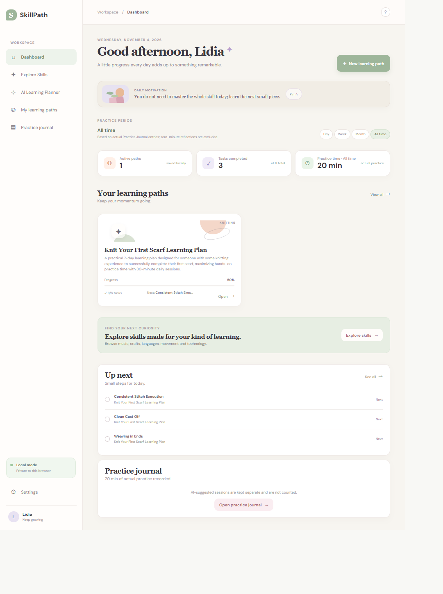
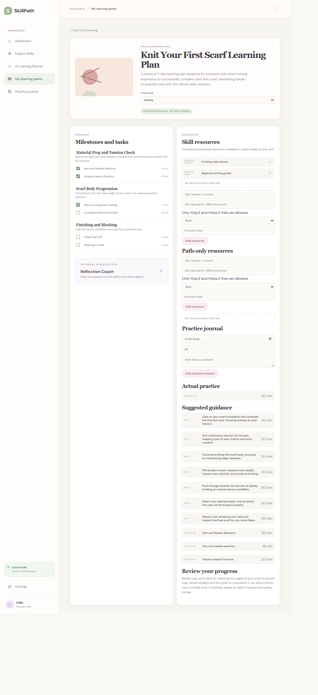
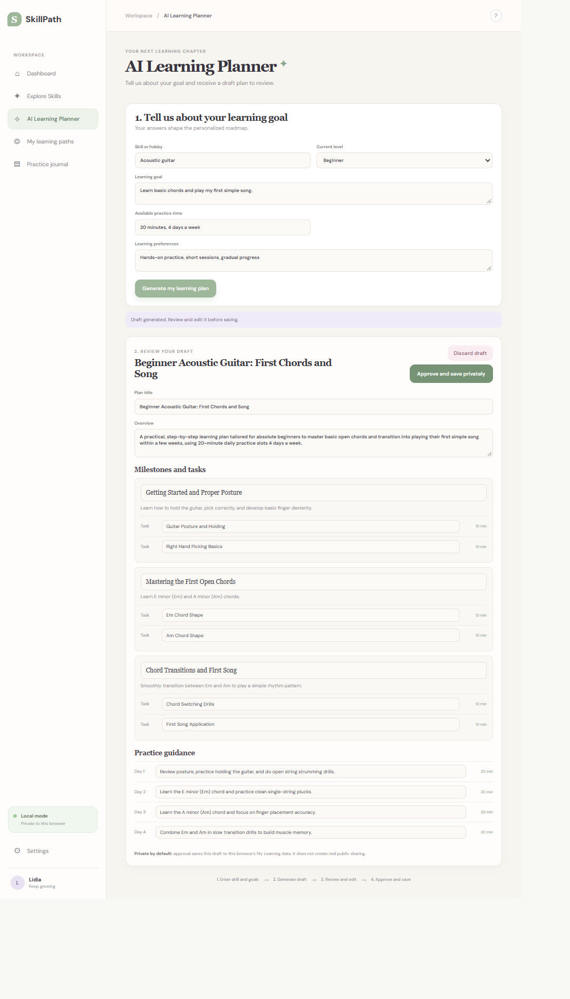

# SkillPath

**A personal learning organizer and progress tracker.**

SkillPath helps users organize goals, document practice, manage learning resources, and track progress across different skills and hobbies. It supports independent learning and activities outside the app rather than providing lessons or courses.

## Features

- **Learning paths:** Create and manage goals, milestones, and tasks.
- **Explore Skills:** Browse skills or create custom skills and categories.
- **Practice Journal:** Record lessons, independent practice, and reflections.
- **Progress tracking:** View practice time by day, week, month, or all time.
- **Learning resources:** Organize books, courses, teachers, and useful links.
- **AI assistance:** Generate editable learning plans and reflect on recorded progress using Gemini.
- **Local data management:** Store learning data in the browser and export/import JSON backups.
- **Personalization:** Customize the learner name, skill icons, and colors.

## Tech Stack

- React, TypeScript, and Vite
- Node.js HTTP server
- Zod validation
- Google Gemini (`@google/genai`)
- Browser `localStorage`

## AI Integration

Gemini is optional and accessed through the backend, keeping the API key server-side.

The AI Learning Planner generates editable plans that users review before saving. The Reflection Coach provides read-only feedback based on recorded activities and uses Gemini function calling to calculate practice consistency.

## Getting Started

**Requirements:** Node.js and npm.

Install dependencies:

```bash
npm install
```

Create a `.env` file using `.env.example`. To enable Gemini features, configure:

```env
PORT=8787
GEMINI_API_KEY=your-api-key
GEMINI_MODEL=gemini-2.5-flash
```

Start the backend:

```bash
npm run server
```

In a separate terminal, start the frontend:

```bash
npm run dev
```

Open `http://localhost:5173`.

Core organizing and tracking features work without a Gemini API key.

## Development Commands

```bash
npm test
npm run lint
npm run build
```

## Screenshots

### Dashboard


### Explore Skills
[View the full skill catalog](docs/screenshots/explore-skills.png)

### Learning Path


### AI Learning Planner


### Additional views
- [Practice Journal](docs/screenshots/practice-journal.png)
- [Gemini Reflection Coach](docs/screenshots/reflection-coach.png)

## Project Status

SkillPath is an experimental portfolio project built primarily using **GitHub Copilot Agent**.

The development process explores AI-assisted software creation through natural-language instructions, iterative testing, and refinement, with human direction of product requirements, design decisions, and functional verification.

Learning data is currently stored locally in the browser. User accounts and cloud synchronization are not implemented.